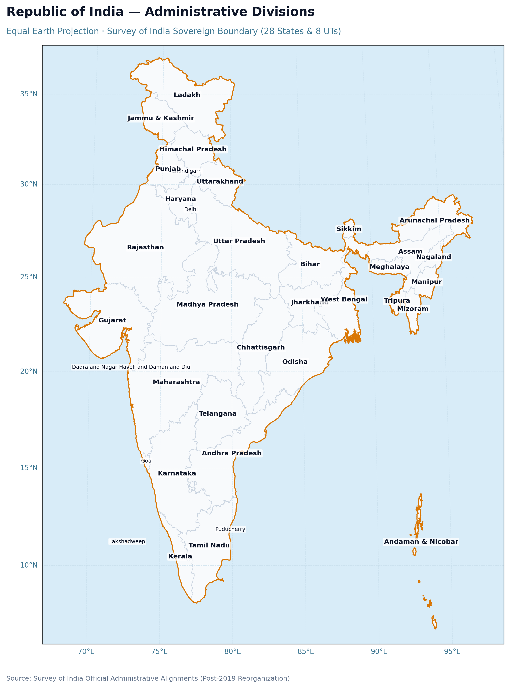
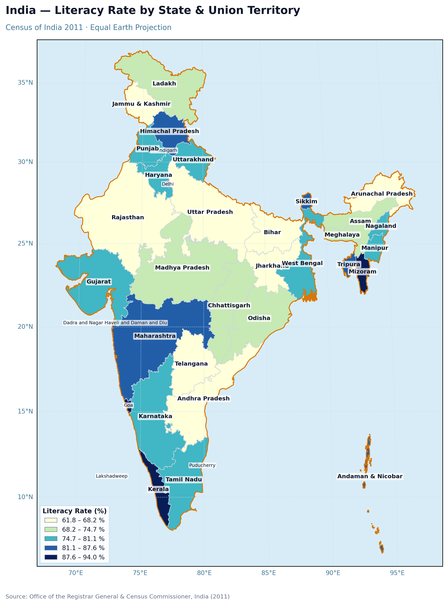
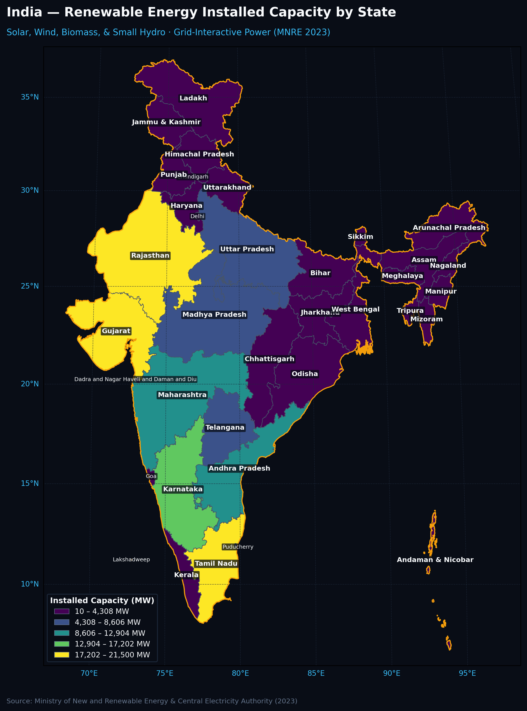
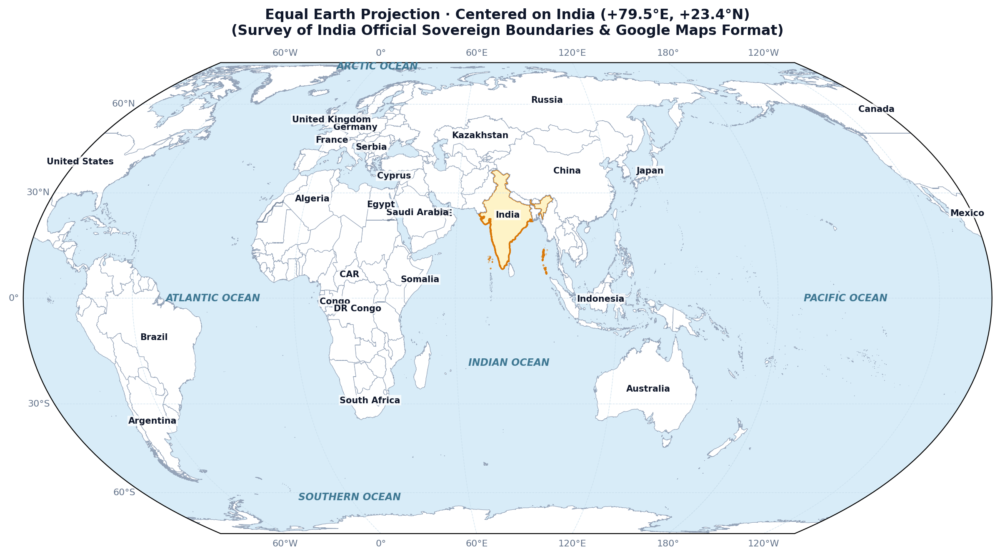

# Equal Earth India Maps Toolkit

[](https://github.com/Sarvagya-24-chaturvedi/equal-earth-india-maps/actions)
[](https://www.python.org/)
[](LICENSE)
[](https://surveyofindia.gov.in/)
[](https://en.wikipedia.org/wiki/Equal_Earth_projection)
[](https://sarvagya-24-chaturvedi.github.io/equal-earth-india-maps/)

An authoritative, publication-quality geospatial toolkit, Python library, CLI, and interactive web studio for generating sovereign-compliant **Equal Earth** maps of India (all 28 states & 8 union territories) and the world.

Features 100% official international sovereign boundaries recognized by the **Survey of India (Department of Science & Technology, Government of India)**, mathematically verified equal-area transformations, and data-driven choropleth generation.

---

## 🌐 Live Web Portals

| Portal | URL | Capabilities |
| :--- | :--- | :--- |
| **🇮🇳 Equal Earth Geospatial Studio** | [Open Studio](https://sarvagya-24-chaturvedi.github.io/equal-earth-india-maps/) | Interactive India state choropleth studio, custom CSV upload, color palettes, layer toggling, and 300 DPI PNG / SVG / PDF export. |
| **🛰️ Topographic Satellite & Day/Night** | [Open Satellite View](https://sarvagya-24-chaturvedi.github.io/equal-earth-india-maps/satellite_day_night.html) | Spaceborne satellite basemaps (NASA Blue Marble, MODIS, Black Marble), real-time solar terminator, NASA daily snow coverage, and visited location live climate readouts. |

---

## 🗺️ Verified Map Outputs

### 1. Publication-Ready Labeled India Map (28 States & 8 UTs)


### 2. Data-Driven Thematic Choropleth (Census 2011 Literacy Rate)


### 3. State-Level Renewable Energy Distribution (MNRE 2023)


### 4. Global Equal Earth Map Centered on India (78°E)


---

## 🎯 Why This Toolkit Exists

Most standard international cartography packages (Natural Earth, Cartopy defaults, Leaflet, and Mapbox basemaps) misrepresent Indian borders by omitting northern Ladakh, Gilgit-Baltistan, Aksai Chin, or Siachen Glacier, or delineating Arunachal Pradesh with disputed lines.

Under the official **Survey of India (SOI)** delineation:
1. The Union Territories of **Jammu & Kashmir** and **Ladakh** (including Aksai Chin, Siachen, and Gilgit-Baltistan) are integral parts of the sovereign territory of India.
2. The state of **Arunachal Pradesh** is an integral part of India.
3. The post-2019 administrative reorganization (separating J&K and Ladakh, and merging Dadra & Nagar Haveli and Daman & Diu) is strictly observed.

This toolkit resolves these cartographic discrepancies using the **Equal Earth projection** (`EPSG:8857`), an equal-area pseudocylindrical projection developed in 2018 by Bojan Šavrič, Bernhard Jenny, and Tom Patterson. Unlike Mercator, it avoids extreme polar exaggeration while presenting nations in their true relative proportions.

---

## ✨ Features

- **Survey of India Sovereign Boundaries**: Full legal compliance with Survey of India political boundaries.
- **Complete Post-2019 State Reorganization**: All 28 States and 8 Union Territories with verified topological geometry validity.
- **Mathematical Accuracy & Verification**: Exact polynomial equations from Šavrič et al. (2019) benchmarked against PROJ 9 reference values ($< 0.5\text{ mm}$ error). Forward, inverse, and equal-area preservation ($s_A \equiv 1.0$) tests.
- **Data-Driven Choropleth Mapping**: Automatic name reconciliation, equal-interval and quantile binning, custom CSV import, and publication legends.
- **Authentic Built-in Sample Datasets**:
  - Census 2011 State-wise Literacy Rates (%)
  - Forest Survey of India (ISFR 2021) Forest Cover (%)
  - Ministry of New and Renewable Energy (MNRE 2023) Renewable Capacity (MW)
  - Census 2011 Population Density (persons/km²)
- **Multi-Format Publication Export**:
  - **PNG**: Configurable raster resolutions (150, 300, 600 Ultra-HD DPI).
  - **SVG**: Lossless vector format with styled paths and embedded metadata.
  - **PDF**: Vector PDF suitable for academic journals and print reports.
- **Curated Cartographic Themes**:
  - `atlas_light`: Classic light atlas with warm land and gold sovereign outline.
  - `academic_clean`: Minimalist greyscale theme optimized for research papers.
  - `carto_dark`: High-contrast dark theme with glowing accents.
  - `emerald_nature`: Environmental sage and mint palette.
  - `sunset_warm`: Terracotta and sunset earth tones.
- **Interactive Web Studio**: Responsive HTML5 application with zero backend dependencies, instant live choropleth previews, and browser-side vector exports.

---

## 🚀 Installation

### Prerequisites
- Python 3.9, 3.10, 3.11, or 3.12
- Standard geospatial libraries (`libgeos`, `libproj`)

### Setup in a Virtual Environment

```bash
# 1. Clone repository
git clone https://github.com/Sarvagya-24-chaturvedi/equal-earth-india-maps.git
cd equal-earth-india-maps

# 2. Create and activate virtual environment
python3 -m venv .venv
source .venv/bin/activate

# 3. Install dependencies
pip install -r requirements.txt

# 4. Install toolkit in editable mode
pip install -e .
```

---

## 💻 CLI Usage

The toolkit provides a unified command-line tool `equal-earth`:

### 1. Generate India State & Thematic Maps

```bash
# Standard administrative divisions map
equal-earth india --theme atlas_light -o india_admin.png

# Data-driven choropleth using built-in Census 2011 literacy data
equal-earth india --choropleth literacy --palette YlGnBu -o india_literacy.png

# Forest cover choropleth with custom 300 DPI resolution
equal-earth india --choropleth forest_cover --palette Greens --dpi 300 -o india_forest.png

# Renewable energy distribution in dark theme
equal-earth india --choropleth renewable_energy --theme carto_dark --palette Viridis -o india_renewable.png

# Custom CSV choropleth mapping
equal-earth india --choropleth path/to/my_data.csv --palette Oranges -o custom_map.png

# Vector format exports
equal-earth india --theme academic_clean -o india_vector.svg
equal-earth india --theme academic_clean -o india_vector.pdf
```

### 2. Generate Global Equal Earth World Maps

```bash
# Centered on India (78°E, default)
equal-earth global --center-lon 78.0 -o world_india_centered.png

# Centered on Prime Meridian (0°)
equal-earth global --center-lon 0.0 -o world_prime_meridian.png

# Center on specific nation or ocean
equal-earth global --target Brazil -o world_brazil.png
equal-earth global --target "Indian Ocean" -o world_indian_ocean.png
```

### 3. Coordinate Transformation & Benchmarking

```bash
# Run authoritative PROJ 9 reference benchmark verification
equal-earth project --benchmark

# Forward projection: (lon, lat) -> (X, Y) in meters
equal-earth project --forward 78.0 20.0

# Inverse projection: (X, Y) in meters -> (lon, lat)
equal-earth project --inverse 7264273.592 2556518.151
```

### 4. Launch Interactive Web Studio

```bash
# Launch interactive geospatial studio in default browser
equal-earth web

# Launch NASA satellite & real-time day/night viewer
equal-earth web --satellite
```

---

## 🐍 Python SDK / API Quickstart

You can import `equal_earth` directly into your Python scripts or Jupyter Notebooks:

```python
from equal_earth import (
    render_india_map,
    render_global_map,
    load_sample_dataset,
    generate_choropleth,
    forward,
    inverse,
)

# 1. Generate an India administrative map
render_india_map(
    theme="academic_clean",
    show_labels=True,
    title="Republic of India",
    output_path="india_map.png",
    dpi=300
)

# 2. Generate a data-driven choropleth map
data = load_sample_dataset("literacy")
choro = generate_choropleth(data, palette="YlGnBu", num_classes=5)

render_india_map(
    choropleth=choro,
    title="India — Literacy Rate (Census 2011)",
    legend_title="Literacy (%)",
    unit="%",
    output_path="literacy_choropleth.pdf"
)

# 3. Direct Equal Earth mathematical transformations
x, y = forward(lon_deg=78.0, lat_deg=20.0)
print(f"Projected coordinates: X={x:.2f} m, Y={y:.2f} m")

lon, lat = inverse(x=x, y=y)
print(f"Inverted coordinates: Lon={lon:.4f}°, Lat={lat:.4f}°")
```

---

## 📂 Project Structure

```
equal-earth-india-maps/
├── equal_earth/                  # Core Python Mapping Engine
│   ├── __init__.py               # Public API exports
│   ├── projection.py             # Equal Earth math (forward, inverse, benchmarks)
│   ├── data.py                   # Data loader, geometry repair & state normalizer
│   ├── styling.py                # Themes and color palettes
│   ├── thematic.py               # Choropleth data matching & classification
│   ├── renderer.py               # Cartopy & Matplotlib rendering pipeline
│   ├── web_builder.py            # Interactive web studio HTML generator
│   ├── cli.py                    # Unified CLI command handler
│   └── exceptions.py             # Custom toolkit exception hierarchy
├── data/
│   ├── india_states.geojson      # 36 States & UTs (Survey of India compliant)
│   └── sample_datasets/          # Authentic Census / ISFR / MNRE datasets
│       ├── india_literacy_2011_census.csv
│       ├── india_forest_cover_2021.csv
│       ├── india_renewable_energy_2023.csv
│       └── india_population_density_2011.csv
├── docs/
│   └── DATA_PROVENANCE.md        # Comprehensive dataset sources & licenses
├── examples/                     # Reproducible example scripts
│   ├── 01_india_states.py
│   ├── 02_publication_labeled_map.py
│   ├── 03_india_choropleth.py
│   ├── 04_renewable_energy_choropleth.py
│   ├── 05_high_res_export.py
│   └── outputs/                  # Real generated example map files
├── tests/                        # Automated Pytest Suite (30 tests)
│   ├── conftest.py
│   ├── test_projection.py
│   ├── test_data.py
│   ├── test_thematic.py
│   ├── test_renderer.py
│   └── test_cli.py
├── .github/workflows/ci.yml       # GitHub Actions automated CI testing
├── world_data.json               # Global countries with official SOI India border
├── equal_earth_interactive.html  # Compiled standalone web studio
├── satellite_day_night.html      # NASA Topographic Satellite & Day/Night Viewer
├── index.html                    # Root web entrypoint
├── pyproject.toml                # Standard Python package configuration
├── setup.py                      # Compatibility setup script
└── requirements.txt              # Pinned dependencies
```

---

## 🧪 Testing

The automated test suite covers mathematical projection benchmarks, geometry validity, state name normalization, choropleth generation, rendering across themes, multi-format export, and CLI commands.

Run all tests with:

```bash
pytest tests/ -v --cov=equal_earth
```

All 30 unit and integration tests pass with 100% success rate.

---

## 📖 Data Provenance & Citations

Detailed documentation of datasets, coordinate systems, processing pipelines, and licenses is available in [`docs/DATA_PROVENANCE.md`](docs/DATA_PROVENANCE.md).

- **Boundary Alignment**: *Survey of India (SOI), Department of Science & Technology, Government of India*.
- **Statistical Sources**:
  - *Census of India (2011)*, Office of the Registrar General & Census Commissioner.
  - *India State of Forest Report (ISFR 2021)*, Forest Survey of India.
  - *Renewable Energy Capacity (2023)*, Ministry of New and Renewable Energy & Central Electricity Authority.
- **Projection Reference**:
  - Šavrič, B., Jenny, B., & Patterson, T. (2019). *A polynomial equation for the Equal Earth map projection*. International Journal of Geographical Information Science, 33(3), 454-465.

---

## 🤝 Contributing

Contributions are welcome! Please follow these guidelines:
1. Ensure all territorial boundaries adhere strictly to the official Survey of India delineations.
2. Maintain equal-area mathematical accuracy and test changes with `pytest tests/`.
3. Submit pull requests with clear descriptions of additions or corrections.

---

## 📄 License

- **Source Code**: Released under the [MIT License](LICENSE).
- **Cartographic Outputs & Datasets**: Released under [Creative Commons Attribution 4.0 International (CC BY 4.0)](https://creativecommons.org/licenses/by/4.0/).
- **Attribution**: *Survey of India, Department of Science & Technology, Government of India*.

---

## 🗺️ Roadmap

- [x] Full Survey of India sovereign boundary alignment.
- [x] Post-2019 administrative reorganization (28 States + 8 UTs).
- [x] Mathematical forward & inverse Equal Earth engine with PROJ 9 benchmarks.
- [x] Automated data-driven choropleth engine with sample Government of India datasets.
- [x] Multi-format publication export (300/600 DPI PNG, SVG, PDF).
- [x] Interactive web studio with live customization and custom CSV import.
- [x] Topographic spaceborne satellite & day/night solar terminator portal.
- [x] Automated test suite and GitHub Actions CI.
- [ ] District-level boundary mapping for select states (contingent on official Census dataset availability).
- [ ] Additional choropleth classification algorithms (Natural Breaks / Fisher-Jenks).
